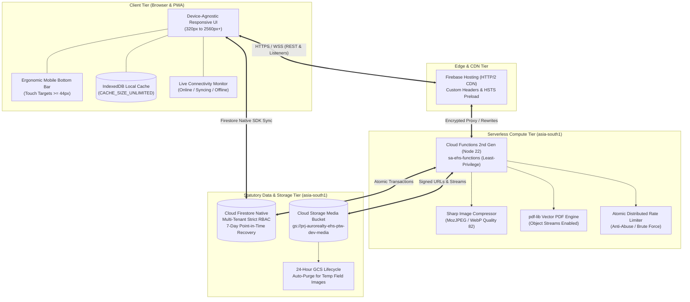
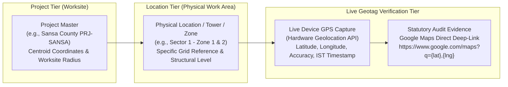

# Auro Realty EHS Permit-to-Work (PTW) Enterprise Platform

[](https://console.cloud.google.com/home/dashboard?project=prj-aurorealty-ehs-ptw-dev)
[-008160?style=flat-square&logo=googlecloud&logoColor=white)](https://cloud.google.com/about/locations/mumbai)
[](https://prj-aurorealty-ehs-ptw-dev.web.app)
[](https://nodejs.org/)
[](https://www.meity.gov.in/content/digital-personal-data-protection-act-2023)
[](#8-enterprise-security-hardening-checks-0106)
[](#6-offline-engine--live-connectivity-architecture)

> **Enterprise Digital Safety Governance & Statutory Permit-to-Work Platform**  
> **Target Worksite Portfolio:** *The Pearl* (`PRJ-PEARL`), *The Regent* (`PRJ-REGENT`), *Sansa County* (`PRJ-SANSA`)  
> **Production Deployment URL:** [https://prj-aurorealty-ehs-ptw-dev.web.app](https://prj-aurorealty-ehs-ptw-dev.web.app)  
> **Statutory Jurisdiction:** Republic of India (Ministry of Labour & Employment, Factories Act 1948, BOCW Act 1996, DPDP Act 2023)

---

## Table of Contents

1. [Executive Overview & Statutory Mandate](#1-executive-overview--statutory-mandate)
2. [High-Level System Architecture](#2-high-level-system-architecture)
3. [10 Statutory PTW Governance Modules](#3-10-statutory-ptw-governance-modules)
4. [Multi-Tenant Worksite Hierarchy & RBAC Model](#4-multi-tenant-worksite-hierarchy--rbac-model)
5. [Real Worksite Topological Baseline](#5-real-worksite-topological-baseline)
6. [Offline Engine & Live Connectivity Architecture](#6-offline-engine--live-connectivity-architecture)
7. [Universal Responsive UI/UX Design System](#7-universal-responsive-uiux-design-system)
8. [Enterprise Security Hardening (Checks 01–06)](#8-enterprise-security-hardening-checks-0106)
9. [Repository & Directory Structure](#9-repository--directory-structure)
10. [CI/CD Pipeline & Automated Deployment](#10-cicd-pipeline--automated-deployment)
11. [Verification & Static Test Suite](#11-verification--static-test-suite)

---

## 1. Executive Overview & Statutory Mandate

The **Auro Realty Private Limited (ARPL) EHS Permit-to-Work (PTW)** system is a mission-critical, enterprise-grade safety governance platform engineered to eliminate high-hazard construction incidents, enforce statutory compliance, and digitize end-to-end permit lifecycles across Pan-India mega-construction sites.

### Key Governance Principles

- **Zero Paperwork, Zero Bypass:** Completely replaces vulnerable physical paper forms with cryptographically signed, timestamped, and geofence-verified digital permits.
- **Dual-Tier Statutory Approval Topologies:** High-risk activities mandate multi-stage approvals across technical reviewers (Site Engineers, MEP Leads), statutory safety officers (EHS Officers, EHS Managers), and executive leadership (Project Managers).
- **Haversine GPS Geofence Locks:** Enforces mathematical coordinate verification (default 75m–100m radius) before an initiator or supervisor can create, verify, or close a permit at a specific tower or zone.
- **Statutory Weekend Protocols:**
  - *Saturday Cutoff:* Permits scheduled for Sunday work must be fully submitted and pre-authorized before **Saturday 12:00 PM IST**.
  - *Sunday Zero-Creation Lockout:* Direct Sunday permit creation is strictly prohibited; unapproved activities are physically locked out.
- **Statutory Data Retention & DPDP Act 2023:** All permit interactions, approvals, gas tests, and tamper-evident audit logs are stored immutably in Mumbai (`asia-south1`) with a mandatory 7-year statutory retention schedule.

---

## 2. High-Level System Architecture

The platform operates on a **100% Serverless, High-Availability Cloud Architecture** hosted within Google Cloud Platform (`asia-south1`):



### Infrastructure Specifications

| Component | Technology | Configuration & Policy |
| :--- | :--- | :--- |
| **GCP Project** | `prj-aurorealty-ehs-ptw-dev` | Bound to corporate organization billing and access management |
| **Primary Region** | `asia-south1` (Mumbai, India) | Strict domestic data residency; zero cross-border transfer |
| **Frontend Shell** | HTML5, Modern CSS3, Vanilla ES2022 | Zero heavy frontend framework overhead; sub-second cold loads |
| **Database** | Cloud Firestore (Native Mode) | Continuous Point-in-Time Recovery (PITR); multi-tenant isolation |
| **Backend Compute** | Cloud Functions 2nd Gen | Auto-scaling instances; execution identity `sa-ehs-functions` |
| **Image Compression** | `sharp` v0.33+ | Max compression downscale to 1920x1080; 97% storage reduction |
| **PDF Generation** | `pdf-lib` v1.17+ | Stream-compressed statutory PDFs (6 pages < 380KB) |
| **Storage Lifecycle** | Google Cloud Storage | Temporary inspection photos auto-deleted strictly after 24 hours |

---

## 3. 10 Statutory PTW Governance Modules

The application implements full operational lifecycles for all **10 High-Hazard Work Classes**:

| Module Code | Permit Classification | Statutory Pre-Requisites & Engineering Controls | Mandatory Approver Topology |
| :--- | :--- | :--- | :--- |
| **PTW-001** | **Excavation & Trenching** | Underground utility detection scan, soil classification, 45° angle of repose or shoring/shielding, trench edge barricades (min 1m setback), ingress/egress ladders every 7.5m. | Site Supervisor → Site Engineer → EHS Officer → Project Manager |
| **PTW-002** | **Hot Work** | Combustible materials cleared within 11m (35ft), fire blanket shielding, dual calibrated $CO_2$ & DCP fire extinguishers, continuous 30-min post-work fire watch. | Site Supervisor → Site Engineer → EHS Officer → Safety Lead |
| **PTW-003** | **Height Work / Guard Rail Removal** | Fall protection required at $\ge 1.8\text{m}$, full body double-lanyard harness with shock absorber, 100% tie-off to certified life line, scaffold green tag inspection. | Site Supervisor → Safety Inspector → EHS Officer → Construction Lead |
| **PTW-004** | **Confined Space Entry** | 4-gas atmosphere calibration ($O_2: 19.5\%-23.5\%$, $CO < 25\text{ ppm}$, $H_2S < 10\text{ ppm}$, $\text{LEL} < 5\%$), continuous mechanical ventilation, dedicated external stand-by rescuer. | Site Supervisor → Gas Testing Officer → EHS Manager → Project Manager |
| **PTW-005** | **Heavy Equipment / Shaft Work** | Lift shaft barricades, shaft top safety nets, equipment load testing certificate, operator third-party competency card, signalman deployed. | Equipment Supervisor → Mechanical Engineer → EHS Officer → Project Admin |
| **PTW-006** | **Electrical Work / LOTO** | Lockout/Tagout (LOTO) on primary isolator, voltage detector verification (zero energy state), arc flash PPE, insulated tools (1000V rated), licensed electrician. | Licensed Electrician → Electrical Engineer → EHS Officer → Site Lead |
| **PTW-007** | **Drilling & Blasting** | PESO magazine statutory license, 500m danger zone clearance siren protocol, vibration monitoring seismograph, licensed DGMS certified blaster. | Certified Blasting Master → Mining Engineer → EHS Manager → Worksite VP |
| **PTW-008** | **General High-Hazard Work** | Heavy civil demolition, structural precast erection, chemical handling, heavy vibratory roller operations, localized dust suppression. | Work Supervisor → Civil Engineer → EHS Officer → Project Manager |
| **PTW-009** | **Heavy Lifting Operations** | Crane load chart computation, outrigger ground bearing pressure check, rigging gear inspection (slings/shackles tagged), tandem lift study. | Certified Rigger → Lifting Engineer → EHS Officer → Project Manager |
| **PTW-010** | **Night Shift Work** | Minimum 50 lux general work lighting / 100 lux hazard point illumination, illuminated emergency escape routes, site first-aid officer and vehicle on standby. | Night Shift In-Charge → Site Engineer → Night EHS Officer → PM On-Call |

---

## 4. Multi-Tenant Worksite Hierarchy & RBAC Model

The system enforces a **strict, multi-tenant governance model** with defense-in-depth authorization checks across the client UI, Cloud Functions, and Firestore security rules:

```
[Enterprise Super Admin] (aic1176@aurogroup.com)
  ├── Global Governance, System Settings & Master Projects
  ├── Provisions Site Administrators in Firestore /users
  └── Inspects Immutable Pan-India Statutory Audit Logs
        │
        ▼
[Project Site Administrator] (e.g., admin.pearl@aurorealty.com)
  ├── Worksite Geofence Lock (Lat, Lng, Radius, Towers/Zones)
  ├── Strictly Scoped to Assigned projectId (Zero IDOR Cross-Site Access)
  └── Empanels Worksite Operational Staff in Firestore /users:
        ├── Work Initiators (Contractor Supervisors, Sub-Contractors)
        ├── Technical Reviewers (Civil Engineers, MEP Leads, Quality Leads)
        └── Statutory Approvers (EHS Officers, EHS Managers, Project Managers)
```

### Authorization Matrix

| System Role (`role`) | UI Role Key (`key`) | Scope Boundaries | Operational Permissions |
| :--- | :--- | :--- | :--- |
| **Super Admin** | `super-admin` | Global Enterprise (Pan-India) | Full system governance, register new worksites, provision Site Admins, global audit log exports. |
| **Project Admin** | `admin` / `project-admin` | Single Assigned Worksite | Configure worksite GPS coordinates, edit towers/zones, empanel worksite staff, monitor site KPIs. |
| **Project Manager** | `pm` / `project-manager` | Single Assigned Worksite | Executive approval for high-risk permits, permit suspension, project-level incident reporting. |
| **EHS Manager** | `ehs-manager` | Single Assigned Worksite | Senior safety sign-off, SLA oversight, gas test validation, statutory PDF single-use downloads. |
| **EHS Officer** | `ehs` / `ehs-officer` | Single Assigned Worksite | Physical field inspection, safety checklist verification, PPE verification, permit issuance. |
| **Site Engineer** | `engineer` / `site-engineer` | Single Assigned Worksite | Technical engineering review, structural load checks, service isolations, scaffolding approvals. |
| **Site Supervisor** | `supervisor` / `site-supervisor` | Single Assigned Worksite | Pre-work checklist execution, toolbox talk (TBT) conduction, field photo capture, permit initiation. |
| **Licensed Electrician** | `electrician` | Single Assigned Worksite | PTW-006 LOTO execution, electrical lockout tags, live-line proximity verification. |
| **Contractor Initiator** | `contractor` | Single Assigned Worksite | Permit drafting, agency worker manifest declaration, safety equipment declaration. |

---

## 5. Real Worksite Topological Baseline & Dynamic Geotagging Architecture

Every permit and user account is strictly bound to a validated structural hierarchy loaded dynamically from Firestore `projects/{projectId}` backed by immutable authoritative configurations.

### Authoritative Worksite Configuration Matrix

| Worksite Project | Project ID | Authoritative Towers & Zones Count | Authoritative Tower / Zone Manifest | Centroid GPS Baseline | Allowed Geofence Radius | Assigned Administrator |
| :--- | :--- | :---: | :--- | :--- | :---: | :--- |
| **The Pearl** | `PRJ-PEARL` | **12** | `P1`, `P2`, `P3`, `P4`, `P5`, `P6`, `P7`, `Clubhouse`, `Podium`, `NTA_PHASE-1`, `NTA_PHASE-2`, `NTA_PHASE-3` | `17.4375° N, 78.3650° E` | `100m` | Empaneled Site Admin (`PRJ-PEARL`) |
| **The Regent** | `PRJ-REGENT` | **7** | `Tower 4`, `Tower 5`, `NTA`, `Stores`, `FormWork`, `Precast`, `Phase-1` | `17.4420° N, 78.3710° E` | `75m` | Empaneled Site Admin (`PRJ-REGENT`) |
| **Sansa County** | `PRJ-SANSA` | **3** | `Sector 1 - Zone 1 & 2`, `Sector 1 - Zone 03`, `Sector 1 - Zone 04` | `17.4510° N, 78.3820° E` | `100m` | Empaneled Site Admin (`PRJ-SANSA`) |

### Dynamic Project-Based Dropdown Logic

- **Role-Based Worksite Scoping:**
  - **Super Admin:** Authorized to view, switch, and provision across all worksites. The worksite selector dynamically populates the project dropdown (`#newStaffProject`), and switching projects instantly loads only that project's authoritative towers.
  - **Site Admin:** Structurally locked to their assigned worksite (e.g., `The Pearl (PRJ-PEARL)` or `Sansa County (PRJ-SANSA)`). The worksite selector is read-only and locked; the tower/zone dropdown displays only towers configured for their assigned worksite.
- **Dynamic Invalidation & Cache Reset:** Changing the selected worksite immediately flushes dependent dropdown state, clears any pre-selected tower/zone, and populates the authoritative manifest for the newly selected project.
- **Permanent Purge of Generic Placeholders:** Generic demo tower options (`Tower A`, `Tower B`, `Tower C`, `Tower D`) are permanently eliminated from production accessors, database initializers, and UI dropdowns.
- **Backend Role Guard:** Cloud Function `adminAssignProjectRole` strictly validates `cleanLocationName` and `cleanLocationId` against `AUTHORITATIVE_PROJECT_TOWERS[projectId]`, rejecting mismatched or generic tower assignments with `invalid-argument`.

### Location vs. Project Geotagging Architecture

The platform enforces strict conceptual and operational separation between **Project** and **Location**:



1. **Macro Worksite (Project):** Represents the macro construction site boundary (e.g., Sansa County, The Pearl, The Regent) governed by site-level boundary coordinates and statutory license.
2. **Micro Work Area (Location):** Represents the specific physical tower, zone, floor, or underground structure where high-risk work is actively executed (e.g., `Sector 1 - Zone 1 & 2`, `P1`, `Clubhouse`).
3. **Mandatory Live Device Geotagging:**
   - Geotags must be captured directly from the physical field device via the browser/device Geolocation API (`enableHighAccuracy: true`).
   - Synthetic, randomized, or project centroid coordinates are strictly blocked; silent fallback to project-level coordinates is prohibited.
   - If device GPS is denied or unavailable, the application displays an explicit error message with a retry mechanism.
4. **Data Persistence Schema:** Database documents and API payloads explicitly separate worksite metadata from device geotags:
   ```json
   {
     "projectId": "PRJ-SANSA",
     "projectName": "Sansa County",
     "locationId": "LOC-SANSA-Z12",
     "locationName": "Sector 1 - Zone 1 & 2",
     "latitude": 17.45102,
     "longitude": 78.38204,
     "accuracy": 8,
     "geotaggedAt": "2026-11-06T13:40:00.000Z"
   }
   ```
5. **Interactive Google Maps Deep-Linking:** All permit inspection views, statutory audit logs, and PDF export manifests feature direct Google Maps verification links (`https://www.google.com/maps?q={latitude},{longitude}`) for instant field-coordinate verification.

### Mobile Safari Viewport & Ergonomic Safe-Area Clearance

On iOS Safari and modern mobile browsers, the floating bottom URL and navigation bar dynamic height can occlude bottom dashboard widgets and action footers. The platform resolves this with:
- Dedicated safe area bottom padding: `padding-bottom: calc(140px + env(safe-area-inset-bottom, 34px)) !important;` across all mobile viewport breakpoints (`<= 768px`, `<= 640px`, `<= 580px`).
- Explicit mobile viewport clearance anchors (`.mobile-viewport-clearance`) on governance dashboards to ensure all administrative cards (`Recent Administrative Actions`, `Audit Trail`) remain completely visible and interactive above the browser chrome.

---

## 6. Offline Engine & Live Connectivity Architecture

Field inspectors frequently operate in subterranean basements, deep trenches, and reinforced concrete elevator cores where cellular connectivity is intermittent. The platform incorporates a **Native IndexedDB Multi-Tab Offline Persistence Engine**:

### Architecture & Synchronization Lifecycle

```
[Browser Client]
  ├── User fills permit / captures signature / updates checklist
  ├── Firestore SDK writes mutation immediately to IndexedDB Cache
  ├── Offline state detected via window 'online' / 'offline' event listeners
  │
  ├── [State: OFFLINE]
  │     ├── Topbar Connectivity Pill turns Crimson: 'Offline'
  │     ├── Global Offline Banner slides into view (Alert: zero data loss)
  │     └── All local reads/writes continue uninterrupted
  │
  └── [State: RECONNECTED]
        ├── Topbar Connectivity Pill turns Amber: 'Syncing'
        ├── Firestore SDK flushes pending mutation queue over secure WebSocket
        └── Topbar Connectivity Pill returns to Emerald: 'Online'
```

### Topbar Live Connectivity Status Indicators

| Pill State | Indicator Appearance | System Status & Behavior |
| :--- | :--- | :--- |
| **Online** | `[●] Online` (Emerald Green) | Active bidirectional WebSocket channel to Cloud Firestore; real-time push active. |
| **Syncing** | `[●] Syncing...` (Amber) | Background flush of pending local mutations from IndexedDB cache to cloud database. |
| **Offline** | `[●] Offline` (Crimson Red) | Operating in standalone local cache mode; zero data loss; reads and writes preserved in IndexedDB. |

---

## 7. Universal Responsive UI/UX Design System

The application has been engineered to provide an uncompromising, device-agnostic user experience across every form factor:

### Supported Viewport Matrix

| Device Category | Viewport Range | Optimized Layout & Ergonomic Features |
| :--- | :--- | :--- |
| **Ultra-Wide Workstations** | $\ge 1920\text{px}$ | High-density 4-column KPI analytics grid; wide 12-column master permit registers; max content constraint ($1560\text{px}$ to $1920\text{px}$) preventing eye strain. |
| **Standard Desktops & Laptops** | $1025\text{px} - 1919\text{px}$ | Fluid 2-column split workspaces; sticky left navigation sidebar; comprehensive data tables. |
| **Tablets (Landscape & Portrait)** | $769\text{px} - 1024\text{px}$ | Collapsible drawer sidebar with backdrop; 2-column adaptive form grids; responsive action buttons. |
| **Phablets & Mobile Devices** | $481\text{px} - 768\text{px}$ | Fixed **Ergonomic Mobile Bottom Navigation Bar** (`.mobile-bottom-bar`); single-column stacked forms; table touch scrolling with `.table-wrap`. |
| **Compact Smart Phones** | $320\text{px} - 480\text{px}$ | Fluid typography; safe-area notch and home indicator padding (`env(safe-area-inset-bottom)`); minimum $44\text{px}$ touch targets. |

### Mobile Navigation Bar (`.mobile-bottom-bar`)

On viewports $\le 768\text{px}$, the desktop sidebar tucks away into an off-canvas drawer, and an ergonomic bottom bar takes over with 5 quick-access actions:
- **Dashboard:** Instant jump to role-filtered KPI console.
- **Permits:** Direct access to the live permit register and search filters.
- **Quick Action (+):** Role-aware floating action button (Initiators create permits; Admins access configuration).
- **Alerts:** Unread notification count badge and pending statutory approvals.
- **Menu:** Opens the comprehensive off-canvas drawer navigation.

---

## 8. Enterprise Security Hardening (Checks 01–06)

The application has been audited and hardened according to enterprise security standards:

```
[CHECK 01: Secure Authentication]
  ├── Cryptographic client password generation (window.crypto.getRandomValues)
  ├── Strict complexity validator (>= 10 chars, uppercase, lowercase, numbers, symbols)
  ├── Brute-force mitigation: 5 failed attempts locks user out for 15 minutes
  └── Automated 30-minute session inactivity logout

[CHECK 02: Prevent Unauthorized Data Access & IDOR]
  ├── Firestore Security Rules strictly scope Project Admins to their assigned projectId
  ├── Site staff, roles, and permits restricted from cross-project reads/writes
  └── Document ownership validated on every state mutation

[CHECK 03: Secure Deployment & Immutable Logging]
  ├── Strict HTTP Security Headers injected via firebase.json:
  │     HSTS (max-age=31536000; preload), CSP, X-Frame-Options: DENY, X-Content-Type-Options: nosniff
  └── Immutable statutory audit logs in Firestore capturing actor UID, IP, and timestamp

[CHECK 04: Abuse & Bot Protection]
  ├── Distributed atomic rate limiting in Cloud Functions (transactions on rate_limits/{key})
  └── Limits on login attempts, user creation, and statutory PDF downloads

[CHECK 05: Protect Secrets & Credentials]
  ├── Keyless Workload Identity Federation in GitHub Actions (Zero static service account keys)
  ├── Frontend configuration restricted to public Firebase identifiers
  └── Backend secrets managed securely via GCP Secret Manager

[CHECK 06: Validation, Sanitization & Anti-Stored XSS]
  ├── Storage rules prohibit executable/scriptable files (Strict rejection of SVG, HTML, JS)
  ├── Whitelist restricted to raster images: image/jpeg, image/png, image/webp
  └── Strict input sanitization in Cloud Functions preventing NoSQL injection and prototype pollution
```

---

## 9. Repository & Directory Structure

```
arpl-ehs-ptw-main/
├── .github/
│   └── workflows/
│       └── deploy.yml              # Keyless CI/CD GitHub Actions Pipeline
├── functions/
│   ├── index.js                    # Cloud Functions 2nd Gen (Rate Limiting, PDF Engine, Sharp)
│   ├── package.json                # Node.js 22 LTS dependencies (sharp, pdf-lib, firebase-admin)
│   └── package-lock.json
├── public/
│   ├── index.html                  # Production Single-Page Web Application
│   ├── firebase-config.js          # Client-side Firebase configuration template
│   ├── config.projects.json        # Worksite baseline topology definitions
│   ├── 404.html                    # Single-Page App router fallback
│   ├── auro-realty-logo.png        # Official Auro Realty high-resolution asset
│   └── auro-realty-gradient.png    # Official Auro Realty brand gradient swatch
├── tests/
│   ├── run_all_tests.js            # Comprehensive static test suite runner
│   ├── test_navigation_application_wide.js
│   ├── test_responsive_viewports.js
│   ├── test_audit_remediation_security.js
│   └── ... (24 statutory workflow & class test suites)
├── firebase.json                   # Hosting rewrites, caching rules & enterprise HTTP headers
├── firestore.rules                 # Multi-tenant IDOR-safe Firestore security rules
├── firestore.indexes.json          # Composite query index definitions
├── storage.rules                   # Hardened Cloud Storage rules (Anti-Stored XSS / Raster Only)
├── gcs-lifecycle.json              # 24-hour temporary media auto-purge lifecycle rule
├── setup-landing-zone.ps1          # GCP Landing Zone automated provisioning script (PowerShell)
├── setup-landing-zone.sh           # GCP Landing Zone automated provisioning script (Bash)
├── package.json                    # Workspace testing & linting scripts
└── README.md                       # Enterprise Engineering Specification & Manual
```

---

## 10. CI/CD Pipeline & Automated Deployment

Deployments to production are completely automated via GitHub Actions using **Keyless Workload Identity Federation** (no long-lived credentials stored in GitHub):

### GitHub Actions Workflow (`.github/workflows/deploy.yml`)

1. **Trigger:** Every push to `main` or manual trigger via `workflow_dispatch`.
2. **Setup:** Node.js 22 LTS environment setup and dependency caching.
3. **Keyless Authentication:** `google-github-actions/auth@v2` exchanges GitHub OIDC tokens with GCP Workload Identity Pool:
   - *Pool:* `projects/1045760890879/locations/global/workloadIdentityPools/github-pool/providers/github-provider`
   - *Service Account:* `sa-github-deployer@prj-aurorealty-ehs-ptw-dev.iam.gserviceaccount.com`
4. **Configuration Injection:** Injects repository secrets (`FIREBASE_API_KEY`, `FIREBASE_APP_ID`, `FIREBASE_MESSAGING_SENDER_ID`) into client configuration files.
5. **Deployment:** Executes `firebase deploy --project prj-aurorealty-ehs-ptw-dev --non-interactive --force` to deploy Hosting, Firestore Rules, Storage Rules, and Cloud Functions 2nd Gen.

---

## 11. Verification & Static Test Suite

To verify code integrity, accessibility, responsive design rules, and security assertions locally before pushing changes:

```powershell
# Execute the comprehensive static test suite
node tests/run_all_tests.js

# Or run the static PowerShell verification script
powershell -ExecutionPolicy Bypass -File scratch/verify_tests.ps1
```

### Static Test Suite Coverage

- **`test_navigation_application_wide.js`:** Verifies modal state lifecycle, focus management, step switches, and scroll preservation.
- **`test_responsive_viewports.js`:** Enforces device-width viewports, touch momentum scrolling, overscroll containment, and breakpoint CSS assertions.
- **`test_audit_remediation_security.js`:** Verifies password complexity checks, brute-force lockout timers, session timeouts, and anti-XSS storage rules.
- **`test_pt01_excavation.js` through `test_pt10_night_shift.js`:** Validates statutory field logic and approval topologies for all 10 permit modules.

---

**Auro Realty Private Limited (ARPL)**  
*Environment, Health & Safety (EHS) Directorate*  
*Galaxy, Plot No. 1, Hyderabad Knowledge City, TSIIC, Raidurg, Hyderabad, Telangana 500081*
